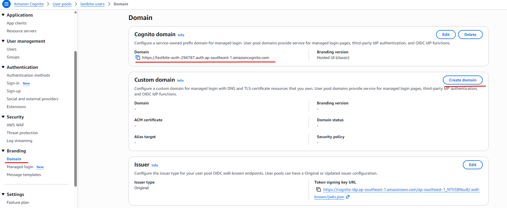

# Hướng dẫn cấu hình Cognito và Google OAuth

Hướng dẫn từng bước để dựng đăng nhập Google qua Cognito cho `lb-api`.
Thiết kế và contract kỹ thuật xem `docs/features/authentication.md`. File này chỉ lo phần
"làm thế nào để cấu hình".

## 0. Tổng quan luồng

- Trình duyệt vào `GET /auth/login` của `lb-api`.
- `lb-api` redirect sang Cognito `/oauth2/authorize` (kèm `identity_provider=Google`).
- Cognito redirect sang Google để chọn tài khoản.
- Google redirect về **Cognito** (`/oauth2/idpresponse`), không về `lb-api`.
- Cognito redirect về `lb-api` `/auth/callback` kèm `code` và `state`.
- `lb-api` đổi `code` lấy token, verify ID token, tạo session và set cookie `lb_session`.

Thứ tự làm bên dưới bám theo phụ thuộc:

- Cognito User Pool và domain phải có trước, vì Google cần biết redirect URI của Cognito domain.
- Google OAuth client phải có trước Identity Provider trong Cognito, vì Cognito cần Client ID và Secret.
- App client của Cognito làm cuối, vì cần Google IdP đã tồn tại.

## 1. Chuẩn bị

- Tài khoản AWS và AWS CLI v2 đã đăng nhập profile dùng được.
  - Kiểm tra: `aws sts get-caller-identity --profile lastbite-dev`.
- Region cố định: `ap-southeast-1`.
- Tài khoản Google để tạo OAuth client (nên là tài khoản của dự án).
- Port local:
  - `lb-api`: `3000`.
  - `lb-customer`: `5173`.
  - `lb-merchant`: `5174`.

## 1.1 Bảng: giá trị nào ghi vào đâu

Tất cả biến Cognito chỉ ghi vào **một nơi**: file `apps/lb-api/.env` (app `lb-api`, thư mục
`apps/lb-api/` của repo này). File này đã được Git ignore.

| Giá trị | Lấy ở bước | Biến môi trường | File / repo |
| --- | --- | --- | --- |
| User pool ID | 2 | `COGNITO_USER_POOL_ID` | `apps/lb-api/.env` |
| Cognito domain | 3 | `COGNITO_DOMAIN` | `apps/lb-api/.env` |
| App client ID | 6 | `COGNITO_CLIENT_ID` | `apps/lb-api/.env` |
| App client secret | 6 | `COGNITO_CLIENT_SECRET` | `apps/lb-api/.env` |
| Callback URL | 6 | `COGNITO_REDIRECT_URI` | `apps/lb-api/.env` |
| URL customer app | 1 | `CUSTOMER_APP_URL` | `apps/lb-api/.env` |
| URL merchant app | 1 | `MERCHANT_APP_URL` | `apps/lb-api/.env` |
| Khoá mã hoá refresh token | 7 | `AUTH_REFRESH_TOKEN_KEY` | `apps/lb-api/.env` |

- **Google Client ID và Client secret (bước 4) không ghi vào biến môi trường nào.**
  - Chỉ dán vào Cognito console (bước 5). Backend không đọc hai giá trị này.
- **`apps/lb-customer` và `apps/lb-merchant` không cần biến Cognito nào.**
  - Không đặt secret vào đó, nhất là biến có prefix `NUXT_PUBLIC_` hoặc `VITE_` (lộ ra trình duyệt).
- Chạy test: cùng bộ biến cần có trong `apps/lb-api/.env.test.local` (file này cũng bị Git ignore).
  - Dùng giá trị test, không dùng secret thật.
- Chạy bằng docker compose: service `lb-api` đọc đúng `apps/lb-api/.env`, không cần file khác.

## 2. Tạo Cognito User Pool

- Vào AWS Console → Cognito → **Create user pool**.
- Chọn loại ứng dụng **Traditional web application**.
- Đặt tên: `lastbite-users`.
- Sign-in identifiers: chọn **Email**.
- Tắt self-registration (không mở đăng ký email/password công khai).
- Plan: **Essentials**.
- Bật **Deletion protection**.
- Hoàn tất tạo pool, ghi lại **User pool ID** (dạng `ap-southeast-1_xxxxxxxxx`).
  - Ghi vào biến `COGNITO_USER_POOL_ID` trong `apps/lb-api/.env`.
- Làm bằng CLI thay cho console: xem mục 4.1 trong `authentication.md`.

## 3. Tạo Cognito domain

- Cognito → User pool vừa tạo → **Branding** → **Domain** → **Create Cognito domain**.
- Nhập prefix duy nhất, ví dụ `lastbite-auth-<số ngẫu nhiên>`.
- Chọn **Hosted UI (classic)** làm phiên bản managed login.
  - Lý do: không cần dựng trang đăng nhập riêng, người dùng đi thẳng sang Google.
- Ghi lại domain đầy đủ:
  - `https://<prefix>.auth.ap-southeast-1.amazoncognito.com`.
  - Ghi vào biến `COGNITO_DOMAIN` trong `apps/lb-api/.env` (có `https://`, không có `/` ở cuối).
- Trang Domain sau khi tạo xong (gạch đỏ: menu **Branding → Domain** và domain cần copy):
  - Phần **Custom domain** không cần làm, bỏ qua.

## 4. Tạo Google OAuth client

- Vào <https://console.cloud.google.com> → chọn hoặc tạo project cho LastBite.
- Vào **Google Auth Platform** → **Branding** (hoặc "OAuth consent screen").
  - Điền App name, email hỗ trợ, email liên hệ.
- Vào **Audience**:
  - Chọn **External**.
  - Giữ trạng thái **Testing** khi phát triển.
  - Thêm mọi tài khoản Google dùng để test vào **Test users**.
    - Tài khoản không có trong danh sách sẽ bị Google chặn.
- Vào **Data Access**: thêm scope `openid`, `email`, `profile`.
- Vào **Clients** → **Create client**:
  - Application type: **Web application**.
  - Name: `lastbite-cognito`.
  - **Authorized JavaScript origins**: `https://<prefix>.auth.ap-southeast-1.amazoncognito.com`.
  - **Authorized redirect URIs**: `https://<prefix>.auth.ap-southeast-1.amazoncognito.com/oauth2/idpresponse`.
- Sau khi tạo, copy **Client ID** và **Client secret**.
  - Secret chỉ lưu ở password manager hoặc secret store, không commit.
  - Hai giá trị này **không ghi vào file `.env` nào**; chỉ dán vào Cognito ở bước 5.

Lỗi hay gặp ở bước này:

- `redirect_uri_mismatch`: redirect URI trong Google khác Cognito domain, sai một ký tự cũng lỗi.
- `Access blocked: app has not completed verification`: tài khoản chưa nằm trong Test users.

## 5. Đăng ký Google làm Identity Provider trong Cognito

- Cognito → User pool → **Authentication** → **Social and external providers** → **Add identity provider**.
- Chọn **Google**.
- Dán **Client ID** và **Client secret** từ bước 4.
- Authorized scopes: `openid email profile`.
- Attribute mapping (Google → Cognito):
  - `email` → `email`.
  - `email_verified` → `email_verified`.
  - `name` → `name`.
  - `picture` → `picture`.
- Lưu lại.
- Làm bằng CLI (tránh để secret vào lịch sử shell): xem mục 4.4 trong `authentication.md`.

Lưu ý:

- Backend dùng Cognito `sub` làm định danh, không dùng email.
- Backend từ chối ID token có `email_verified` khác `true`.

## 6. Tạo App client cho backend

- Cognito → User pool → **Applications** → **App clients** → **Create app client**.
- Loại: **Traditional web application** (confidential client).
- Name: `lastbite-backend`.
- Bật **Generate client secret**.
- Authentication flows: chỉ giữ `ALLOW_REFRESH_TOKEN_AUTH`.
- Token validity:
  - Access token: 1 giờ.
  - ID token: 1 giờ.
  - Refresh token: 7 ngày.
- Bật **Token revocation**, bật **Prevent user existence errors**.
- Hosted UI settings:
  - Identity providers: chỉ chọn **Google** (bỏ Cognito user pool).
  - **Allowed callback URLs**: `http://localhost:3000/auth/callback`.
  - **Allowed sign-out URLs**: `http://localhost:5173` và `http://localhost:5174`.
  - OAuth grant type: **Authorization code grant** (không bật Implicit).
  - OpenID Connect scopes: `openid`, `email`, `profile`.
- Tạo xong, ghi lại:
  - **Client ID** → biến `COGNITO_CLIENT_ID` trong `apps/lb-api/.env`.
  - **Client secret** → biến `COGNITO_CLIENT_SECRET` trong `apps/lb-api/.env`.
  - Callback URL ở trên cũng là giá trị của `COGNITO_REDIRECT_URI` trong `apps/lb-api/.env`.
- Làm bằng CLI: xem mục 4.5 trong `authentication.md`.
  - Không paste nguyên output lệnh này ở đâu cả vì nó chứa secret.

## 7. Cấu hình `lb-api`

- Copy `apps/lb-api/.env.example` thành `apps/lb-api/.env`.
  - File `.env` đã được Git ignore, không commit.
- Điền các biến:
  - `COGNITO_USER_POOL_ID`: từ bước 2.
  - `COGNITO_DOMAIN`: từ bước 3, có `https://`.
  - `COGNITO_CLIENT_ID`, `COGNITO_CLIENT_SECRET`: từ bước 6.
  - `COGNITO_REDIRECT_URI`: `http://localhost:3000/auth/callback`.
    - Phải trùng từng ký tự với **Allowed callback URLs** ở bước 6.
  - `CUSTOMER_APP_URL`: `http://localhost:5173`.
  - `MERCHANT_APP_URL`: `http://localhost:5174`.
  - `REDIS_URL`: Redis local, docker compose map ra cổng `63790` nên dùng `redis://localhost:63790`.
  - `DATABASE_URL`: Postgres local.
  - `APP_ENV`: `development` khi chạy local (cookie `Secure` chỉ bật khi `production`).
  - `AUTH_REFRESH_TOKEN_KEY`: khoá 32 byte, mã hoá base64.
    - Tạo bằng PowerShell:
      `[Convert]::ToBase64String((1..32 | ForEach-Object { Get-Random -Maximum 256 }) -as [byte[]])`
    - Hoặc bằng Node: `node -e "console.log(require('crypto').randomBytes(32).toString('base64'))"`.
    - Mất khoá này thì không giải mã được refresh token đã lưu.
- Với test, `apps/lb-api/.env.test.local` cần đủ cùng bộ biến (dùng giá trị test, không dùng secret thật).
  - Biến nào để trống thì suite test tương ứng sẽ fail với lỗi `... is required`.

## 8. Chạy và kiểm tra

- Khởi động Postgres và Redis (`docker compose up -d` ở thư mục gốc).
- Chạy migration: `npm run db:migrate` trong `apps/lb-api`.
- Chạy API: `npm run start:dev`.
- Kiểm tra từng bước trên trình duyệt:
  - Mở `http://localhost:3000/auth/login?app=customer`.
  - Trình duyệt phải sang trang chọn tài khoản Google.
  - Chọn tài khoản trong danh sách Test users.
  - Sau khi đồng ý, trình duyệt quay về `http://localhost:5173`.
  - DevTools → Application → Cookies: có `lb_session`, cờ **HttpOnly** được bật.
  - Mở `http://localhost:3000/auth/me`: trả về `id`, `email`, `displayName`, `avatarUrl`.
  - Gọi `POST /auth/logout`: trả 204 và cookie bị xoá.
- Đăng nhập lần hai bằng cùng tài khoản:
  - Bảng `users` và `auth_identities` không có thêm dòng mới.
- Mở Swagger tại `http://localhost:3000/api/docs` để thử các endpoint.

## 9. Xử lý lỗi thường gặp

- `redirect_mismatch` ở trang Cognito:
  - `COGNITO_REDIRECT_URI` không trùng **Allowed callback URLs** của app client.
- `redirect_uri_mismatch` ở trang Google:
  - Redirect URI trong Google client chưa đúng `<cognito-domain>/oauth2/idpresponse`.
- `invalid_client` khi đổi code lấy token:
  - Sai `COGNITO_CLIENT_ID` hoặc `COGNITO_CLIENT_SECRET`.
  - App client không bật **Generate client secret** nhưng backend vẫn gửi Basic auth.
- `OAuth state is invalid or expired` (400):
  - Quá 10 phút từ lúc bấm login, state đã dùng rồi, hoặc Redis chưa chạy.
- `Cognito ID token is invalid` (401):
  - `COGNITO_USER_POOL_ID` hoặc `COGNITO_CLIENT_ID` không khớp token.
  - Email chưa verify (`email_verified` khác `true`).
  - Nonce không khớp, thường do mở callback từ một lần login cũ.
- `returnTo is not allowed for this app` (400):
  - `returnTo` khác origin với `CUSTOMER_APP_URL` hoặc `MERCHANT_APP_URL`.
- App khởi động báo `COGNITO_... is required`:
  - Biến env còn trống hoặc sai tên, xem lại mục 7.
- Cookie không được gửi từ frontend:
  - Frontend phải gọi với `credentials: 'include'`.
  - Backend cần bật CORS cho đúng origin kèm credentials (hiện `main.ts` chưa bật).

## 10. Khi lên môi trường thật

- Thêm callback URL và sign-out URL production vào app client, dùng HTTPS.
- Cập nhật `COGNITO_REDIRECT_URI`, `CUSTOMER_APP_URL`, `MERCHANT_APP_URL` theo domain thật.
- Đặt `APP_ENV=production` để cookie có cờ `Secure`.
- Chuyển Google consent screen từ **Testing** sang **In production** khi mở cho người dùng ngoài.
- Lưu secret trong secret store của môi trường deploy, không trong repo (repo public).
- Từ khi Terraform quản lý Cognito, không sửa tay trên console nữa (xem `docs/terraform.md`).
- Secret bị lộ thì rotate ngay:
  - Google client secret: tạo secret mới trong Google, cập nhật Identity Provider trong Cognito.
  - Cognito app client secret: tạo secret mới, cập nhật `COGNITO_CLIENT_SECRET`.
  - `AUTH_REFRESH_TOKEN_KEY`: đổi khoá sẽ làm các session cũ không refresh được.
